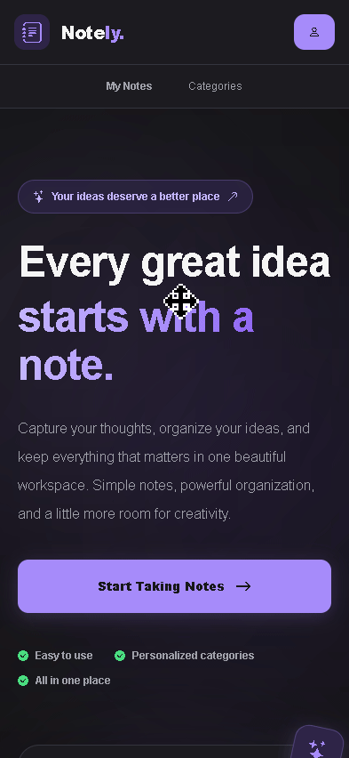
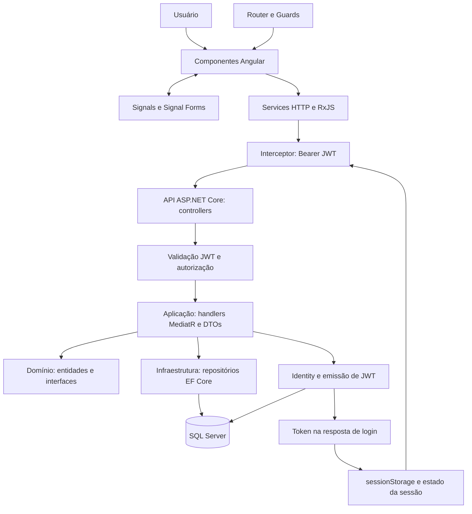
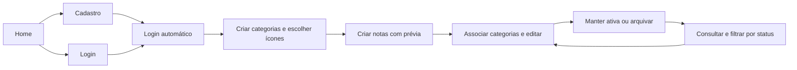

<div align="center">

# Notely

**Suas ideias organizadas, uma nota de cada vez.**

Aplicação web para registrar ideias, organizar anotações por categorias e gerenciar notas pessoais.


<br /><br />


[Visão geral](#visao-geral) · [Arquitetura](#arquitetura) · [Execução local](#execucao-local) · [Endpoints](#endpoints)

</div>

---

<a id="exemplo"></a>

## Exemplo

<p align="center">
  
</p>

<a id="visao-geral"></a>

## Visão geral

O **Notely** oferece um ambiente para guardar ideias e informações pessoais, associar notas a categorias personalizadas e acompanhar seu ciclo de vida entre os estados **Ativa** e **Arquivada**. A interface responsiva com tema escuro reúne autenticação, organização e edição com prévia visual durante o preenchimento.

O projeto integra um frontend Angular a uma API ASP.NET Core com persistência em SQL Server. Cada conta acessa suas próprias notas e categorias. A marca apresentada na interface é Notely; os diretórios, projetos .NET e banco de dados mantêm o nome técnico **NoteKeeper**.

<a id="sumario"></a>

## Sumário

- [Demonstração](#demonstracao)
- [Funcionalidades](#funcionalidades)
- [Arquitetura](#arquitetura)
- [Estrutura do projeto](#estrutura)
- [Tecnologias utilizadas](#tecnologias)
- [Executando o projeto localmente](#execucao-local)
- [Autenticação](#autenticacao)
- [Endpoints](#endpoints)
- [Fluxo funcional](#fluxo)
- [Gerenciamento de notas e categorias](#gerenciamento)
- [Testes automatizados](#testes)
- [Segurança](#seguranca)
- [Build e execução](#build)
- [Ambiente de produção](#producao)
- [Possíveis evoluções](#evolucoes)
- [Status do projeto](#status)
- [Autor](#autor)

<a id="demonstracao"></a>

## Demonstração

O GIF na seção [Exemplo](#exemplo) demonstra o uso da aplicação. Os espaços abaixo estão preparados para documentar as telas quando as capturas forem adicionadas:

| Tela                        | Conteúdo previsto para a captura           | Disponibilidade da imagem |
| --------------------------- | ------------------------------------------ | ------------------------- |
| Home                        | Apresentação do Notely e navegação inicial | A adicionar               |
| Login e cadastro            | Formulários de acesso e criação de conta   | A adicionar               |
| Listagem de notas           | Cartões, categorias e filtros por status   | A adicionar               |
| Cadastro e edição de notas  | Formulários com prévia reativa             | A adicionar               |
| Gerenciamento de categorias | Listagem, edição e seleção de ícones       | A adicionar               |

<!-- Ao adicionar capturas ao repositório, substituir os espaços acima por imagens com caminhos relativos reais. -->

<a id="funcionalidades"></a>

## Funcionalidades

| Área         | Implementação                                                                          |
| ------------ | -------------------------------------------------------------------------------------- |
| Contas       | Cadastro com nome, e-mail e senha; login; exibição do usuário; encerramento da sessão. |
| Autenticação | JWT Bearer, validação no backend e revogação do token no logout.                       |
| Notas        | Criação, listagem, edição e exclusão; datas de criação e atualização.                  |
| Categorias   | Criação, listagem, edição e exclusão; personalização por ícones.                       |
| Organização  | Associação de várias categorias a uma nota, com seleção opcional.                      |
| Status       | Alteração entre Ativa e Arquivada; filtros Todas, Ativas e Arquivadas na listagem.     |
| Formulários  | Validação com Signal Forms e prévia das notas durante cadastro e edição.               |
| Navegação    | Páginas carregadas sob demanda e guards nas rotas de autenticação, notas e categorias. |
| Interface    | Tema escuro e layouts responsivos com Tailwind CSS.                                    |

Os nomes de status exibidos na interface incluem textos em inglês; os contratos da API utilizam `Ativa` e `Arquivada`.

<a id="arquitetura"></a>

## 🏗️ Arquitetura

### Frontend

A aplicação Angular usa **componentes standalone**, organizados por funcionalidade em `components/`: autenticação, notas, categorias e Home, além da navegação e do rodapé.

| Responsabilidade         | Organização                                                                                                                                                                      |
| ------------------------ | -------------------------------------------------------------------------------------------------------------------------------------------------------------------------------- |
| Páginas e interação      | Componentes com templates próprios, formulários e estados de carregamento/erro.                                                                                                  |
| Comunicação HTTP         | `ServiceAuth`, `ServiceNotes` e `ServiceCategories` encapsulam chamadas com `HttpClient` e retornam Observables tipados.                                                         |
| Contratos e apresentação | Arquivos `models.ts` definem interfaces de requisição/resposta; interfaces locais representam formulários; `CategoryViewModel` e seu mapeamento preparam dados para a interface. |
| Estado reativo           | `signal`, `computed` e `effect` controlam dados de formulário, sessão e estado visual; `computed` deriva a lista filtrada e informações de prévia.                               |
| Integração assíncrona    | RxJS coordena chamadas e transformações; `toSignal` e `toObservable` conectam Observables ao estado reativo.                                                                     |
| Formulários              | Signal Forms, de `@angular/forms/signals`, fornece campos, validações e acompanhamento dos valores.                                                                              |
| Rotas                    | Angular Router com `loadComponent`, aliases de redirecionamento e parâmetros vinculados a inputs dos componentes.                                                                |
| Sessão                   | `ServiceStorage` mantém token e nome em `sessionStorage`; `ProvideUser` expõe o estado de autenticação.                                                                          |
| Acesso e requisições     | Guards funcionais controlam a navegação; o interceptor adiciona o JWT somente às requisições destinadas à API configurada.                                                       |
| Erros                    | `src/api/extractApiError.ts` transforma erros HTTP em mensagens para as páginas.                                                                                                 |

Essa divisão concentra a renderização e a interação nos componentes, os contratos nas interfaces e a comunicação com o backend nos services.

### Backend

A solução `server/NoteKeeper.slnx` usa **.NET 10** e separa o backend em quatro projetos:

| Projeto                     | Responsabilidade                                                                                                                               |
| --------------------------- | ---------------------------------------------------------------------------------------------------------------------------------------------- |
| `NoteKeeper.Api`            | Controllers, contratos HTTP, composição de dependências, JWT, CORS, OpenAPI e tradução de resultados para respostas HTTP.                      |
| `NoteKeeper.Aplicacao`      | Casos de uso de autenticação, notas e categorias em comandos/consultas e handlers MediatR; DTOs, mapeamentos e resultados com FluentResults.   |
| `NoteKeeper.Dominio`        | Entidades, regras de validação, status, interfaces de repositórios e abstrações de autenticação. Não referencia os outros projetos da solução. |
| `NoteKeeper.Infraestrutura` | Implementações de repositórios, EF Core, configurações de entidades, migrations, Identity e persistência de tokens revogados.                  |

Os controllers delegam operações aos handlers. Estes dependem de interfaces do domínio, implementadas na infraestrutura e registradas por injeção de dependência. Há separação entre comandos e consultas via MediatR, sem bancos distintos para leitura e escrita. Os repositórios abstraem o acesso ao EF Core.

As entidades `Nota` e `Categoria` possuem vínculo muitos-para-muitos por `NotaCategoria`. Consultas e operações usam o identificador do usuário autenticado para restringir o acesso aos dados. A camada de aplicação verifica regras como duplicidade de títulos e pertencimento das categorias à conta.

Erros de negócio e validação são representados com FluentResults e convertidos em **ProblemDetails** ou **ValidationProblemDetails**. Exceções não tratadas recebem resposta genérica de erro interno.

### Comunicação entre as camadas



O diagrama representa o fluxo de execução. A implementação de persistência é resolvida por injeção de dependência a partir das interfaces do domínio.

<a id="estrutura"></a>

## 📁 Estrutura do projeto

```text
.
├── client/NoteKeeper/
│   ├── public/                         # Recursos estáticos
│   ├── src/
│   │   ├── api/                        # Extração de erros HTTP
│   │   ├── app/
│   │   │   ├── auth/                   # Sessão, guards, interceptor e token da URL
│   │   │   ├── components/
│   │   │   │   ├── auth/               # Login e cadastro
│   │   │   │   ├── categories/         # Páginas de categorias
│   │   │   │   ├── notes/              # Páginas de notas
│   │   │   │   ├── home/               # Apresentação inicial
│   │   │   │   ├── shared/navbar/      # Navegação
│   │   │   │   └── footer/             # Rodapé
│   │   │   ├── enviroments/            # Configuração da URL da API
│   │   │   ├── service/                # Services e interfaces HTTP
│   │   │   ├── app.config.ts           # Providers da aplicação
│   │   │   └── app.routes.ts           # Rotas e guards
│   │   └── styles.css                  # Tema Tailwind e estilos globais
│   ├── angular.json                    # Build, servidor local e testes
│   └── package.json                    # Dependências e scripts npm
├── server/
│   ├── src/
│   │   ├── Api/                        # API HTTP e inicialização
│   │   ├── Aplicacao/                  # Casos de uso, handlers e DTOs
│   │   ├── Dominio/                    # Entidades, regras e interfaces
│   │   └── Infraestrutura/             # EF Core, migrations e Identity
│   ├── tests/NoteKeeper.Tests/         # Testes de domínio e aplicação
│   ├── dotnet-tools.json               # Manifesto do CLI do EF Core
│   └── NoteKeeper.slnx                 # Solução do backend
└── README.md
```

<a id="tecnologias"></a>

## 🛠️ Tecnologias utilizadas

As versões abaixo são as declaradas em `package.json` e nos arquivos `.csproj`. Os intervalos npm foram preservados; o `package-lock.json` registra a resolução das dependências.

### Frontend

| Tecnologia                      | Versão    | Uso                                                |
| ------------------------------- | --------- | -------------------------------------------------- |
| Angular e Angular Router        | `^22.2.0` | Componentes standalone, navegação e guards.        |
| Angular Signals e Angular Forms | `^22.2.0` | Estado reativo, dados derivados e Signal Forms.    |
| TypeScript                      | `~6.0.2`  | Tipagem dos componentes, services e contratos.     |
| RxJS                            | `~7.8.0`  | Observables e composição de operações assíncronas. |
| Tailwind CSS                    | `^4.1.12` | Estilização, tema e responsividade.                |
| Bootstrap Icons                 | `^1.13.2` | Ícones da interface e das categorias.              |

### Backend e banco de dados

| Tecnologia                                | Versão                        | Uso                                                   |
| ----------------------------------------- | ----------------------------- | ----------------------------------------------------- |
| C# e ASP.NET Core                         | .NET 10 (`net10.0`)           | API HTTP e injeção de dependência.                    |
| JWT Bearer e Identity EF Core             | `10.0.13`                     | Validação de tokens e gerenciamento de contas/senhas. |
| Entity Framework Core SQL Server e Design | `10.0.13`                     | Repositórios, mapeamentos e migrations.               |
| SQL Server                                | Versão do servidor não fixada | Persistência relacional.                              |
| MediatR                                   | `14.2.0`                      | Despacho de comandos e consultas para handlers.       |
| FluentResults                             | `4.0.0`                       | Resultados e erros dos casos de uso.                  |
| ASP.NET Core OpenAPI                      | `10.0.13`                     | Documento OpenAPI.                                    |
| Swagger UI                                | `10.3.1`                      | Interface de documentação da API.                     |

As regras de validação do domínio são implementadas nas próprias entidades e nos casos de uso; FluentResults transporta seus resultados.

### Ferramentas de desenvolvimento

| Ferramenta                | Versão declarada     | Uso                                           |
| ------------------------- | -------------------- | --------------------------------------------- |
| Angular CLI e Build       | `^22.2.4`            | Servidor de desenvolvimento e compilação.     |
| npm                       | `11.19.0`            | Gerenciador declarado em `packageManager`.    |
| PostCSS / plugin Tailwind | `^8.5.3` / `^4.1.12` | Processamento de estilos.                     |
| Prettier                  | `^3.8.1`             | Formatação.                                   |
| Vitest / jsdom            | `^5.0.0` / `^30.0.0` | Ferramentas de testes do frontend.            |
| xUnit / Moq               | `2.9.3` / `4.20.72`  | Testes unitários e simulação de dependências. |
| Microsoft.NET.Test.Sdk    | `17.13.0`            | Execução dos testes .NET.                     |
| CLI do EF Core            | `10.0.13`            | Aplicação de migrations pelo manifesto local. |

<a id="execucao-local"></a>

## 🚀 Executando o projeto localmente

### 1. Verifique os pré-requisitos

- **Git** para clonar o repositório.
- **Node.js:** `^22.22.3`, `^24.15.0` ou `>=26.0.0`, conforme os requisitos do tooling Angular no `package-lock.json`.
- **npm 11.19.0**, conforme o campo `packageManager`.
- **.NET SDK 10**. Não há `global.json` fixando uma versão de patch.
- **SQL Server** acessível, com uma conta autorizada a criar/atualizar o banco e aplicar migrations. A configuração de desenvolvimento aponta para `localhost,1433` e banco `NoteKeeperDb`.

O Angular CLI é instalado como dependência local; não é necessário instalá-lo globalmente. O repositório não fornece contêiner ou script de provisionamento do SQL Server: prepare a instância antes de iniciar a API.

### 2. Clone o repositório

```bash
git clone https://github.com/Os-Gadeias/NoteKeeper-Kowalski.git
cd NoteKeeper-Kowalski
```

Os comandos do backend a seguir partem da raiz do repositório.

### 3. Restaure as dependências

```bash
dotnet restore server/NoteKeeper.slnx
```

Em outro terminal, instale as dependências do frontend:

```bash
cd client/NoteKeeper
npm ci
```

### 4. Configure o banco de dados e o JWT

Na raiz do repositório, configure os segredos de desenvolvimento. Substitua os placeholders pelos valores do seu ambiente:

```bash
dotnet user-secrets set "ConnectionStrings:SqlServer" "<sua-connection-string-sql-server>" --project server/src/Api/NoteKeeper.Api.csproj
dotnet user-secrets set "Jwt:SigningKey" "<sua-chave-privada-com-pelo-menos-32-bytes>" --project server/src/Api/NoteKeeper.Api.csproj
```

A API já possui `UserSecretsId`. A chave JWT não está definida nos arquivos de configuração e deve conter **pelo menos 32 bytes em UTF-8**. A connection string informada por User Secrets substitui a configuração de desenvolvimento versionada; utilize a conexão da sua própria instância.

`Jwt:Issuer`, `Jwt:Audience` e `Jwt:ExpiresInMinutes` estão definidos em `server/src/Api/appsettings.json`. A validade padrão é de 60 minutos.

| Configuração                  | Variável de ambiente equivalente |
| ----------------------------- | -------------------------------- |
| `ConnectionStrings:SqlServer` | `ConnectionStrings__SqlServer`   |
| `Jwt:SigningKey`              | `Jwt__SigningKey`                |
| `Jwt:Issuer`                  | `Jwt__Issuer`                    |
| `Jwt:Audience`                | `Jwt__Audience`                  |
| `Jwt:ExpiresInMinutes`        | `Jwt__ExpiresInMinutes`          |

O registro do MediatR também lê `LuckyPenny:LicenseKey`. Quando aplicável ao seu licenciamento, configure sua chave:

```bash
dotnet user-secrets set "LuckyPenny:LicenseKey" "<sua-chave-de-licenca>" --project server/src/Api/NoteKeeper.Api.csproj
```

### 5. Aplique as migrations

As migrations estão em `server/src/Infraestrutura/Compartilhado/Orm/Migrations`. A API as aplica automaticamente ao iniciar em **Development**, desde que o SQL Server esteja disponível e a conta tenha as permissões necessárias.

Para aplicá-las explicitamente na raiz do repositório:

```bash
dotnet tool restore --tool-manifest server/dotnet-tools.json
dotnet tool run dotnet-ef --tool-manifest server/dotnet-tools.json -- database update --project server/src/Infraestrutura/NoteKeeper.Infraestrutura.csproj --startup-project server/src/Api/NoteKeeper.Api.csproj
```

A fábrica de contexto usada pelas ferramentas lê User Secrets e variáveis de ambiente. Configure a mesma conexão para a execução da API e das migrations.

### 6. Inicie o backend

```bash
dotnet run --project server/src/Api/NoteKeeper.Api.csproj --launch-profile NoteKeeper.Api
```

O perfil seleciona `Development` e utiliza `http://localhost:5146`, conforme `launchSettings.json`.

### 7. Configure e inicie o frontend

A URL da API está em `client/NoteKeeper/src/app/enviroments/enviroment.develolment.ts`. A grafia abaixo corresponde ao arquivo existente:

```ts
export const environment = {
  urlApi: "http://localhost:5146",
};
```

Altere `urlApi` se a API estiver em outro endereço. O token de injeção `URL_API` importa esse arquivo diretamente; não há substituição de ambiente de produção configurada.

No terminal do frontend, dentro de `client/NoteKeeper`:

```bash
npm start
```

### 8. Acesse a aplicação

| Serviço           | Endereço local                        |
| ----------------- | ------------------------------------- |
| Frontend          | http://localhost:4200/                |
| API               | http://localhost:5146                 |
| Swagger UI        | http://localhost:5146/swagger         |
| Documento OpenAPI | http://localhost:5146/openapi/v1.json |

Crie sua conta pela interface. Após o cadastro, o frontend realiza o login automaticamente. Se alterar a origem do frontend, revise as políticas CORS em `server/src/Api/Program.cs` e `Cors:AllowedOrigins`; a origem local atual é `http://localhost:4200`.

<a id="autenticacao"></a>

## 🔐 Autenticação

1. O cadastro envia nome, e-mail e senha para `POST /auth/cadastro`. O Identity cria a conta e gerencia o hash da senha.
2. O frontend encadeia o cadastro com `POST /auth/login`; usuários existentes utilizam diretamente o login.
3. A API emite um JWT assinado com HMAC-SHA256, contendo a identificação do usuário, identificador do token e expiração.
4. O frontend guarda token e nome em `sessionStorage`, com Signals para refletir o estado da sessão.
5. O interceptor inclui `Authorization: Bearer <token>` somente nas chamadas para a URL base da API configurada.
6. `isAuthenticatedGuard` exige sessão local nas páginas de notas/categorias; `isAnonymousGuard` redireciona usuários autenticados que tentam acessar login/cadastro.
7. O backend valida assinatura, emissor, destinatário, validade e revogação do token. Os recursos são consultados pelo ID da conta autenticada.
8. No logout, a API persiste a revogação do JWT até sua expiração e o frontend limpa a sessão local, inclusive se a notificação à API falhar.

**Os guards controlam a navegação, mas a segurança dos endpoints é garantida pelo backend.** A presença local de um token não comprova sua validade. Não há fluxo de refresh token; após expirar, é necessário autenticar-se novamente.

<a id="endpoints"></a>

## 🔌 Endpoints

### Autenticação

| Método | Endpoint         | Autenticação | Descrição                       |
| ------ | ---------------- | ------------ | ------------------------------- |
| `POST` | `/auth/cadastro` | Pública      | Cria uma conta.                 |
| `POST` | `/auth/login`    | Pública      | Autentica e retorna o JWT.      |
| `GET`  | `/auth/me`       | JWT Bearer   | Consulta o usuário autenticado. |
| `POST` | `/auth/logout`   | JWT Bearer   | Revoga o token atual.           |

Exemplo de corpo para cadastro, com dados ilustrativos:

```json
{
  "nome": "Seu nome",
  "email": "usuario@example.com",
  "senha": "<sua-senha>"
}
```

### Notas

| Método   | Endpoint      | Autenticação | Descrição                                           |
| -------- | ------------- | ------------ | --------------------------------------------------- |
| `GET`    | `/notas`      | JWT Bearer   | Lista notas da conta; aceita filtro por categorias. |
| `GET`    | `/notas/{id}` | JWT Bearer   | Consulta uma nota pelo identificador.               |
| `POST`   | `/notas`      | JWT Bearer   | Cria uma nota inicialmente ativa.                   |
| `PUT`    | `/notas/{id}` | JWT Bearer   | Atualiza conteúdo, status e associações.            |
| `DELETE` | `/notas/{id}` | JWT Bearer   | Exclui uma nota.                                    |

Exemplo de atualização sem categorias:

```json
{
  "titulo": "Planejamento de estudos",
  "descricao": "Revisar os conteúdos da semana.",
  "status": "Arquivada",
  "categoriaIds": []
}
```

Na criação, o corpo contém `titulo`, `descricao` e `categoriaIds`; o status inicial é definido pelo backend. Os valores de `categoriaIds` devem ser GUIDs de categorias pertencentes à conta.

`GET /notas?categoriaIds=<id1>&categoriaIds=<id2>` retorna somente notas associadas a **todas** as categorias informadas. Sem parâmetros, lista todas as notas do usuário. Esse filtro da API é separado do filtro por status realizado no frontend.

### Categorias

| Método   | Endpoint           | Autenticação | Descrição                                 |
| -------- | ------------------ | ------------ | ----------------------------------------- |
| `GET`    | `/categorias`      | JWT Bearer   | Lista categorias da conta.                |
| `GET`    | `/categorias/{id}` | JWT Bearer   | Consulta uma categoria.                   |
| `POST`   | `/categorias`      | JWT Bearer   | Cria uma categoria.                       |
| `PUT`    | `/categorias/{id}` | JWT Bearer   | Atualiza título e ícone.                  |
| `DELETE` | `/categorias/{id}` | JWT Bearer   | Exclui a categoria e preserva suas notas. |

Exemplo de criação ou atualização:

```json
{
  "titulo": "Estudos",
  "icone": "bi-book-fill"
}
```

Os contratos HTTP utilizam campos em português. Há exemplos adicionais em [NoteKeeper.Api.http](server/src/Api/NoteKeeper.Api.http). Erros seguem ProblemDetails: validação `400`, autenticação `401`, recurso não encontrado `404`, conflito `409` e erro interno `500`.

<a id="fluxo"></a>

## Fluxo funcional



A criação de categorias é opcional: notas podem ser registradas sem associações. Arquivar altera o status da nota; excluí-la remove o registro.

<a id="gerenciamento"></a>

## Gerenciamento de notas e categorias

| Regra                 | Comportamento                                                                                                                                               |
| --------------------- | ----------------------------------------------------------------------------------------------------------------------------------------------------------- |
| Títulos               | Notas e categorias exigem entre 2 e 100 caracteres. A unicidade é verificada por usuário, com normalização de caixa e remoção de espaços nas extremidades.  |
| Descrição             | Até 300 caracteres. A API permite descrição ausente; os formulários atuais do frontend exigem preenchimento.                                                |
| Categorias            | Associação opcional e múltipla. A aplicação verifica se as categorias informadas pertencem ao usuário.                                                      |
| Ícones                | Categorias possuem título e ícone; a interface oferece seleção visual de Bootstrap Icons. O domínio aceita um identificador de ícone de 1 a 100 caracteres. |
| Edição                | Atualiza os campos da nota e substitui a lista de categorias. Enviar `categoriaIds: []` remove todas as associações.                                        |
| Exclusão de categoria | Remove a categoria e seus vínculos, preservando as notas.                                                                                                   |
| Status                | Notas começam como `Ativa`; podem mudar para `Arquivada` e voltar a ficar ativas. O arquivamento preserva o conteúdo.                                       |
| Filtros               | Todas apresenta a lista completa; Ativas e Arquivadas selecionam pelo status, no cliente.                                                                   |

Os Signals mantêm os dados dos formulários e a seleção de categorias. Computed Signals derivam título, descrição e seleção para a prévia de cadastro; na listagem, `filteredNotes` combina as notas carregadas com o status selecionado. A edição também renderiza a prévia a partir do estado do formulário, atualizando-a durante o preenchimento.

<a id="testes"></a>

## 🧪 Testes automatizados

O projeto `server/tests/NoteKeeper.Tests` contém **testes unitários com xUnit e Moq**, voltados ao domínio e à camada de aplicação:

| Módulo       | Cenários presentes                                                                                             |
| ------------ | -------------------------------------------------------------------------------------------------------------- |
| Entidades    | Validação de títulos, descrição, status e ícones.                                                              |
| Autenticação | Cadastro, credenciais válidas/inválidas, consulta do usuário e revogação de token.                             |
| Categorias   | Criação, duplicidade, listagem, consulta, atualização, exclusão e validação de ícones.                         |
| Notas        | Criação com status inicial, duplicidade, categorias de outra conta, filtros, consulta, atualização e exclusão. |

Na raiz do repositório:

```bash
dotnet test server/NoteKeeper.slnx
```

O frontend possui Vitest e jsdom configurados pelo builder de testes do Angular, mas ainda não contém arquivos de especificação. O comando disponível, dentro de `client/NoteKeeper`, é:

```bash
npm test
```

Esses testes unitários não substituem testes de integração da API com o banco nem testes de navegação completos. Não há percentual de cobertura informado no repositório.

<a id="seguranca"></a>

## 🛡️ Segurança

- **Contas e senhas:** ASP.NET Core Identity gerencia os hashes e a verificação de senhas. A política exige ao menos oito caracteres, um número e um caractere especial, além de e-mail único.
- **Tentativas de login:** Identity registra falhas; a configuração prevê bloqueio por cinco minutos após cinco tentativas inválidas.
- **JWT:** a API verifica assinatura, emissor, destinatário, validade e identificador de revogação. O logout registra o token revogado no banco.
- **Autorização:** uma política padrão exige autenticação; cadastro e login são explicitamente públicos. As operações pessoais são delimitadas pelo usuário autenticado.
- **Navegação e sessão:** guards restringem as páginas e o interceptor limita o envio do token à API. O token fica em `sessionStorage`, acessível ao JavaScript da aplicação.
- **CORS:** as políticas atuais autorizam a origem local `http://localhost:4200`; origens de outros ambientes precisam ser configuradas e revisadas no backend.
- **Erros:** exceções não tratadas geram ProblemDetails genérico, e a conversão de resultados evita expor detalhes internos em respostas `500`.
- **Configuração sensível:** há uma conexão de desenvolvimento versionada no repositório. Use credenciais próprias, sobreponha a configuração com User Secrets no desenvolvimento e injete segredos pelo ambiente na publicação. User Secrets não é um cofre para produção.

O pipeline inclui redirecionamento HTTPS, mas o perfil local fornecido utiliza HTTP. Certificado e terminação HTTPS precisam ser definidos para um ambiente publicado.

<a id="build"></a>

## Build e execução

### Frontend

Dentro de `client/NoteKeeper`:

```bash
npm start
npm run build
npm test
```

`npm start` inicia o servidor local; `npm run build` utiliza a configuração de produção por padrão. A saída fica em `client/NoteKeeper/dist/NoteKeeper`, com os arquivos do navegador no subdiretório `browser`. `npm test` executa o runner configurado, atualmente sem especificações no frontend.

### Backend

Na raiz do repositório:

```bash
dotnet build server/NoteKeeper.slnx --configuration Release
dotnet test server/NoteKeeper.slnx
dotnet run --project server/src/Api/NoteKeeper.Api.csproj --launch-profile NoteKeeper.Api
```

<a id="producao"></a>

## Ambiente de produção

Não foram identificados URL pública da aplicação, configuração de hospedagem, contêineres ou pipeline de CI/CD versionados. O frontend possui um build de produção, mas o processo de publicação ainda precisa ser definido.

Para preparar esse ambiente, será necessário configurar a URL pública da API, as origens CORS, a conexão SQL Server, os segredos JWT e o HTTPS. A aplicação das migrations também precisa fazer parte do processo de publicação: a migração automática no código ocorre somente em **Development**. O frontend importa diretamente a configuração atual de `urlApi`, sem substituição por ambiente.

<a id="evolucoes"></a>

## Possíveis evoluções

As propostas abaixo representam melhorias futuras, separadas das funcionalidades já implementadas:

- Pesquisa de notas por título e conteúdo.
- Ordenação selecionável por criação ou atualização e paginação.
- Marcação de notas favoritas.
- Ampliação das opções de personalização.
- Revisão de acessibilidade e navegação por teclado.
- Testes de componentes, integração com SQL Server e fluxos completos de navegação.
- Tratamento centralizado de expiração da sessão no frontend.
- Configurações por ambiente e automação de build/publicação.

<a id="status"></a>

## Status do projeto

Funcionalidades confirmadas no código:

- [x] Home com apresentação da aplicação.
- [x] Cadastro e login com JWT.
- [x] Logout com revogação de token e limpeza da sessão.
- [x] CRUD de notas.
- [x] CRUD de categorias com ícones.
- [x] Associação de múltiplas categorias por nota.
- [x] Status Ativa e Arquivada com filtros na listagem.
- [x] Prévia das notas nos formulários de cadastro e edição.
- [x] Guards e interceptor HTTP.
- [x] Interface responsiva com tema escuro.
- [x] Persistência com EF Core, SQL Server e migrations.
- [x] Documentação OpenAPI/Swagger.
- [x] Testes unitários de domínio e aplicação no backend.

<a id="autor"></a>

## Autor

**Thiago Kovalski**

---

<div align="center">

**Conheça o Notely, explore o código e acompanhe sua evolução.**

Se o projeto foi útil ou despertou seu interesse, deixe uma ⭐ no repositório!

[Voltar ao início](#notely)

</div>
